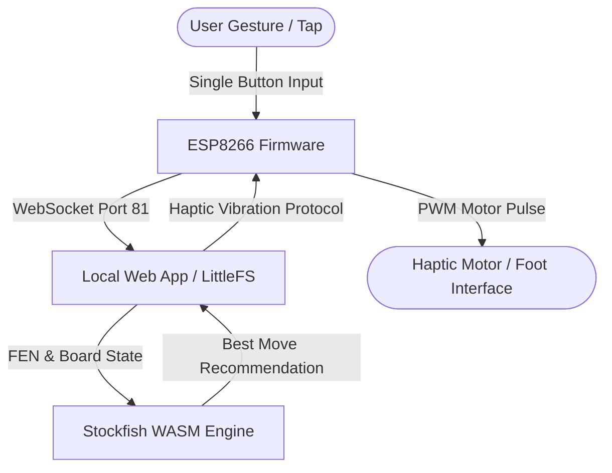

# BlindChess: Covert Haptic Chess Assistance System

**BlindChess** is an assistive tactile chess system engineered for discreet, non-visual interaction. Built on an ESP8266 microcontroller and WebSockets, the device provides real-time chess engine evaluations and move instructions through precision PWM vibration pulses.

---

## 🎯 System Architecture

---

## ⚡ Key Engineering Features

- **Microcontroller Firmware (`blind_chess_complete.ino`)**:
  - Standalone WiFi Access Point (`BlindChess`) serving captive control pages via LittleFS.
  - Asynchronous WebSocket server on port 81 for ultra-low latency bidirection telemetry.
  - Multi-gesture input state machine with 10ms hardware debouncing:
    - **Single Tap**: Increments coordinate counter (1 to 8) with responsive 100ms haptic confirmation.
    - **Long Press (>400ms)**: Confirms rank/file selection and commits the move.
    - **Panic Hold (>15s)**: Triggers fail-safe hardware memory wipe and emergency reset.
- **Embedded Web Client (`/data`)**:
  - Client-side Stockfish WebAssembly chess engine for offline calculation.
  - Tactile coordinate encoding protocol translating complex algebraic notation into intuitive vibration cadence.

---

## 🛠️ Hardware Requirements

| Component | Specification |
|---|---|
| **Microcontroller** | ESP8266 NodeMCU / D1 Mini |
| **Haptic Actuator** | Micro vibration disc motor (PWM modulated) |
| **Driver** | N-channel MOSFET / Transistor circuit with flyback diode |
| **Input Switch** | Tactile momentary push button (insole / foot-actuated) |
| **Power** | 3.7V LiPo battery with TP4056 charging module |

---

## 🚀 Getting Started

### 1. Flashing Firmware (Arduino IDE / PlatformIO)
1. Install the `ESP8266` board definitions.
2. Install dependencies:
   - `WebSockets` by Markus Sattler
   - `ArduinoJson` (v6+)
   - `LittleFS` file system uploader
3. Upload files in the `data/` folder via **ESP8266 LittleFS Data Upload**.
4. Flash `blind_chess_complete.ino` to your ESP8266 board.

### 2. Operational Workflow
1. Power on the device.
2. Connect to WiFi AP: `BlindChess` (Password: `name12@@`).
3. Navigate to `http://192.168.4.1` on any browser to monitor or calibrate engine depth and vibration intensity.

---

## 📄 License
This project is open-source under the [MIT License](LICENSE).
